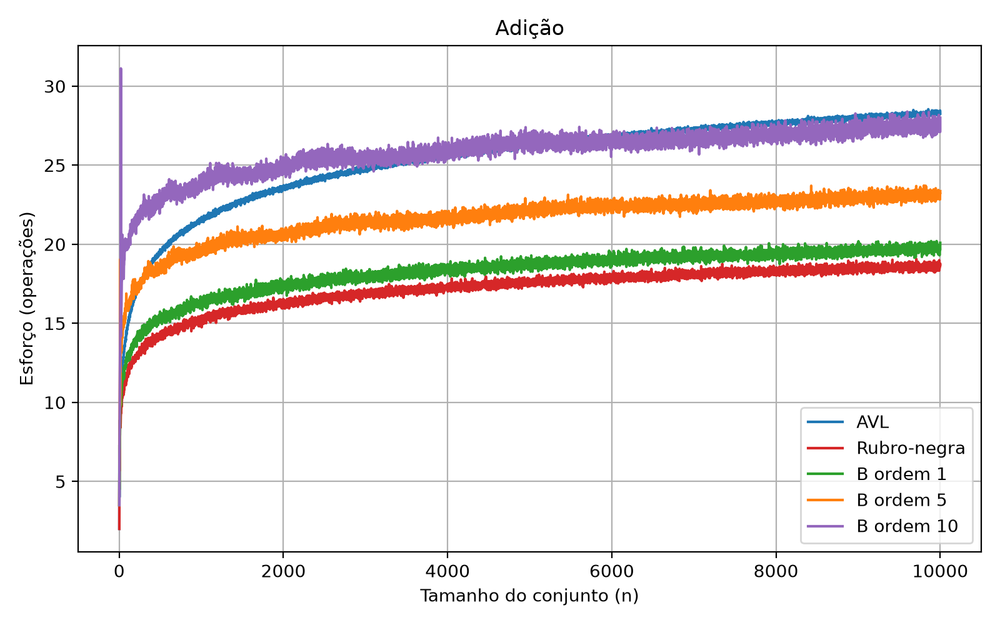
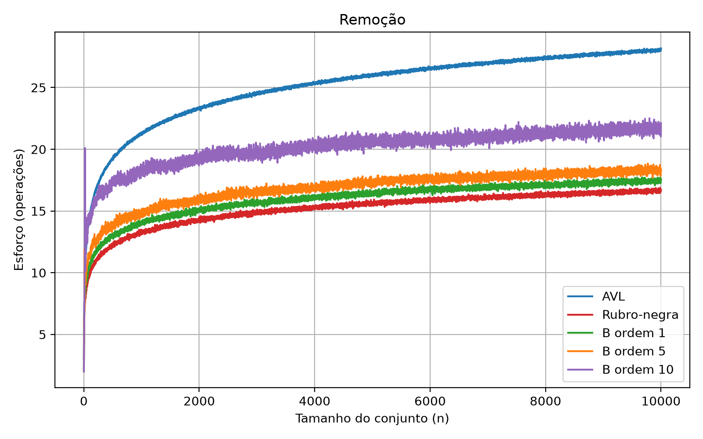

# Esforço de adição e remoção em árvores AVL, rubro-negra e B

Trabalho final de Estrutura de Dados II. Mede o esforço computacional da adição e da remoção de chaves, contando o balanceamento, na árvore AVL, na rubro-negra e na árvore B de ordem 1, 5 e 10, com conjuntos de 1 a 10000 chaves aleatórias. O enunciado está em [trabalho.md](trabalho.md).

As árvores estão em C, em `src/`. O `main.py` compila o executável, roda o experimento e gera os gráficos.

## Requisitos

- `gcc`
- Python 3
- as dependências do Python:

```
python -m venv .venv && .venv/bin/pip install -r requirements.txt
```

## Comandos

```
.venv/bin/python main.py rodar avl --n 1000 --semente 1
```

Roda uma estrutura (`avl`, `rn`, `b1`, `b5` ou `b10`) com uma árvore de n chaves e mostra busca, ajuste e total de uma adição e de uma remoção. Compila `build/arvores` se ele não existir ou estiver mais antigo que algum arquivo de `src/`. Para compilar à parte: `main.py compilar`.

```
.venv/bin/python main.py experimento
```

Roda as 5 estruturas com n de 1 a 10000 e 1000 amostras e grava `resultados/esforco.xlsx` (médias) e `resultados/amostras.csv` (cada amostra). Cada par (estrutura, semente) é uma chamada ao executável, e as chamadas rodam em paralelo. A execução completa levou 7327 s (cerca de 2 h) num processador com 12 threads. Opções: `--estruturas`, `--n-max`, `--passo`, `--amostras` e `--saida`.

```
.venv/bin/python main.py graficos
```

Lê `resultados/esforco.xlsx` e grava os gráficos em `graficos/`, em PNG.

O executável também roda sozinho: `build/arvores <estrutura> <semente> <n> [n ...]` imprime uma linha `n,adicao_busca,adicao_ajuste,remocao_busca,remocao_ajuste` para cada n.

## Métrica

O esforço de uma operação é `busca + ajuste`, contados no código C (`src/contador.h`):

|Evento|Contador|
|---|---|
|Cada nó examinado na descida (AVL e rubro-negra: cada comparação com o valor do nó; B: cada iteração da pesquisa binária dentro do nó)|busca|
|Cada passo até o sucessor (AVL e rubro-negra) ou até o predecessor (B) na remoção|busca|
|B: cada posição examinada procurando o nó entre os filhos do pai|busca|
|AVL: cada nó visitado pelo balanceamento|ajuste|
|Cada rotação simples (a dupla conta 2)|ajuste|
|Rubro-negra: cada iteração do laço de correção, na inserção e na remoção|ajuste|
|Rubro-negra: cada atribuição de cor dentro da correção, inclusive a que pinta de preto no fim do laço|ajuste|
|AVL: desligar o nó removido. Rubro-negra: cada `transplantar`|ajuste|
|Cópia de chave entre nós (sucessor na AVL, predecessor na B)|ajuste|
|B: cada chave escrita em posição nova (deslocamento, split, promoção, empréstimo entre irmãos e fusão)|ajuste|

A destruição da árvore não conta.

A AVL segue o código da disciplina: depois de cada adição ou remoção, o balanceamento sobe do pai do nó alterado até a raiz recalculando a altura de cada nó. Por isso o `ajuste` dela cresce com a altura da árvore mesmo quando não há rotação.

## Experimento

- Sementes de 1 a 1000. Para cada semente e cada n, as chaves são uma permutação de 1..n+1 embaralhada com `rand`.
- A árvore é montada do zero para cada n com as n primeiras chaves da permutação, sem contar esforço.
- **Adição**: insere a chave que sobrou (uma chave aleatória numa árvore de n chaves) e conta o esforço dessa única operação.
- **Remoção**: em seguida sorteia uma das n+1 chaves presentes, remove e conta o esforço dessa única operação. A árvore tem n+1 chaves nesse momento.
- A mesma semente gera os mesmos conjuntos em todas as estruturas.

Cada ponto dos gráficos é a média das 1000 amostras.

## Dados

`resultados/esforco.xlsx` tem as abas:

- **Adição** e **Remoção**: n e o esforço médio de uma operação em cada estrutura, com um gráfico de linhas;
- **AVL**, **Rubro-negra**, **B ordem 1**, **B ordem 5** e **B ordem 10**: médias de busca, ajuste e total da adição e da remoção, mais o desvio padrão do total entre as amostras;
- **Sobre**: o que cada coluna conta e os parâmetros da execução.

`resultados/amostras.csv` sai da mesma execução, com uma linha por (estrutura, semente, n) e `adicao_busca`, `adicao_ajuste`, `remocao_busca` e `remocao_ajuste` sem média. São 50 milhões de linhas (cerca de 1,7 GB), por isso não está no repositório; `main.py experimento` gera o arquivo de novo.

## Gráficos

Esforço de uma adição e de uma remoção numa árvore de n chaves, média das 1000 amostras. Cada ponto da planilha é um ponto do gráfico.




